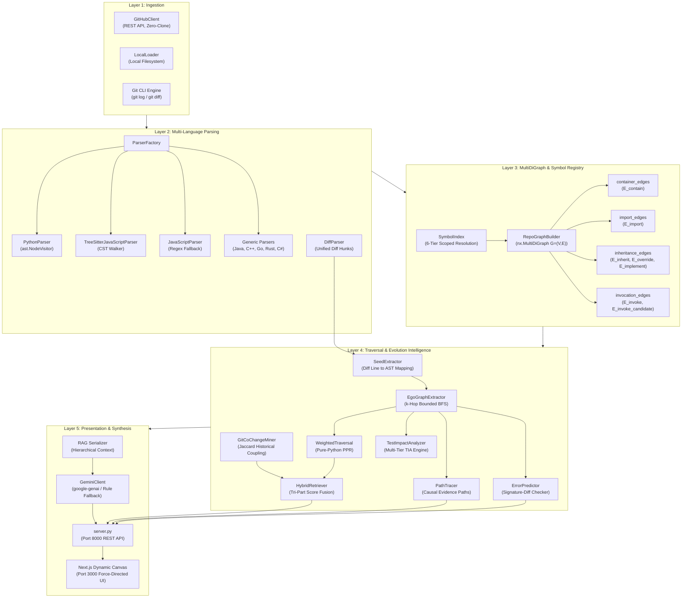
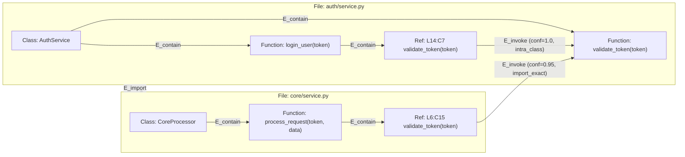
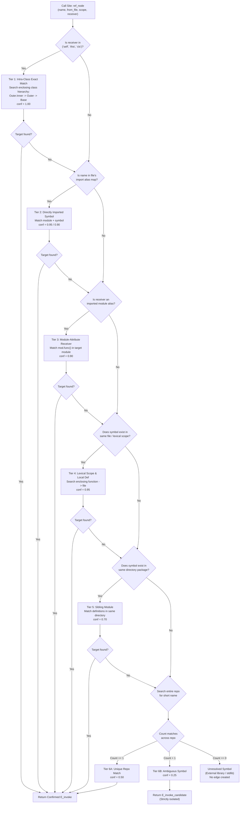
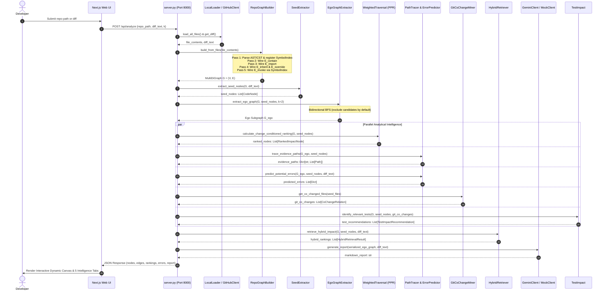
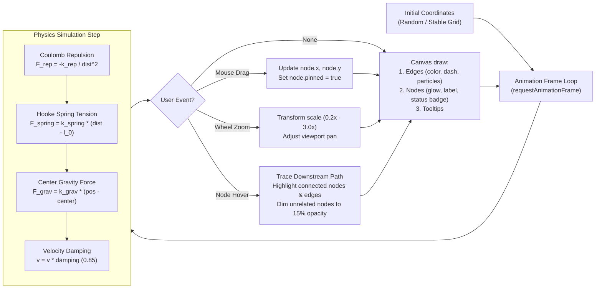

# Codelysis: Architecture & Workflows
## Visual Architecture Diagrams, Sequence Workflows, and Dataflow Specifications

---

## 1. High-Level System Architecture

Codelysis separates concerns across five distinct architectural layers:
1. **Source Ingestion Layer:** Zero-clone GitHub API or local filesystem reader.
2. **Language Parsing & AST/CST Engine:** Python AST, Tree-sitter CST, and regex fallback parsers.
3. **Graph Construction & Symbol Indexing Layer:** MultiDiGraph builder, 6-tier scoped symbol resolver, and typed edge generators.
4. **Traversal, Evolution & Causal Intelligence Layer:** Seed mapper, ego-subgraph extractor, weighted Personalized PageRank, Git co-change miner, path tracer, and error predictor.
5. **Presentation & Synthesis Layer:** Graph-RAG serializer, Google Gemini LLM reasoning, REST API server, and Next.js force-directed interactive canvas.



---

## 2. Graph Schema & Typed Multigraph Representation

Codelysis represents repositories using `networkx.MultiDiGraph`. Two identical nodes can be connected by multiple parallel edges of distinct relationship types without overwriting each other.



### 2.1 Node Data Model
```python
CodeNode(
    node_id="auth/service.py:L14:C7:ref:validate_token",
    file="auth/service.py",
    line=14,
    name="validate_token",
    type="ref",                         # "def" or "ref"
    category="call",                    # "class", "function", "method", "call", "file"
    end_line=14,
    start_col=7,
    end_col=21,
    qualified_name="auth.service.login_user.validate_token",
    signature="()",
    docstring="",
    parent_scope="login_user",
    snippet="    if not validate_token(token):",
    metadata={"receiver": None, "arg_count": 1, "kw_names": []}
)
```

### 2.2 Edge Data Model
Each edge in the `MultiDiGraph` is indexed by `(u, v, key, data)`:
- **`E_contain` Key:** `f"E_contain:{v}"`
- **`E_invoke` Key:** `f"E_invoke:{v}"`
- **`E_invoke_candidate` Key:** `f"E_invoke_candidate:{v}"`
- **`E_import` Key:** `f"E_import:{symbol}:{target_node_id}"`
- **`E_inherit` Key:** `f"E_inherit:{target_class_id}"`
- **`E_override` Key:** `f"E_override:{sub_class_id}:{sm.node_id}:{base_method.node_id}"`

---

## 3. Six-Tier Scoped Symbol Resolution Decision Tree

When resolving a call site `ref_node` to its target `def_node`, the `SymbolIndex` executes this deterministic decision hierarchy:



---

## 4. End-to-End Change Impact Sequence



---

## 5. Force-Directed Canvas Physics Architecture

The Next.js frontend (`frontend/components/GraphCanvas.jsx`) renders an interactive, physics-driven dependency graph using an HTML5 Canvas and a custom Euler-Verlet integration loop:



### 5.1 Color Palette & Node Visual Semantics
- **Seed Node (`#ef4444` Red):** Directly modified definition in Git diff. Pulsing radial glow.
- **Direct Caller (`#f97316` Orange):** 1-hop confirmed caller (`E_invoke`).
- **Indirect Caller (`#eab308` Yellow):** 2-hop transitive caller.
- **Unit Test Harness (`#06b6d4` Cyan):** Caller residing in a test file (`tests/test_*.py`).
- **Callee (`#8b5cf6` Purple):** Outgoing dependency called by modified seed.
- **Normal Entity (`#1e293b` Dark Slate):** Contextual structural entity.

---

## 6. Layer-by-Layer Data Contract Specifications

| Layer | Input Data Structures | Processing Logic | Output Data Structures |
| :--- | :--- | :--- | :--- |
| **1. Ingestion** | GitHub slug / Local dir path | File tree traversal; git diff execution | `Dict[str, str]` (file contents), `diff_text: str` |
| **2. Parsing** | `(file_path, content_str)` | AST visitor / Tree-sitter CST traversal | `List[CodeNode]` (defs), `List[Tuple[CodeNode, Optional[str]]]` (refs) |
| **3. Graph Construction** | Definitions, references, imports | 6-tier `SymbolIndex` resolution; multi-edge insertion | `nx.MultiDiGraph G = (V, E)` |
| **4. Seed Extraction** | Unified diff string, Graph $G$ | Hunk header scanning; line-to-interval matching | `List[CodeNode]` (seed nodes $S \subseteq V$) |
| **5. Subgraph Extraction** | Graph $G$, Seed nodes $S$, $k$ hops | Breadth-first search excluding candidates | Induced subgraph `G_ego = G[V_ego]` |
| **6. Weighted Traversal** | Graph $G$, Seed nodes $S$ | Relationship-weighted Personalized PageRank | `List[RankedImpactNode]` (PPR scores, severity tiers) |
| **7. Error Prediction** | Diff text, Subgraph $G_{ego}$ | AST signature-diff parameter mismatch check | `List[Dict]` (predicted `TypeError`, `AttributeError`) |
| **8. Test Impact Analysis** | Graph $G$, Seeds $S$, Co-changes | Multi-tier test detection (Direct, Indirect, Co-change, Candidate) | `List[TestImpactRecommendation]` (prioritized test suites) |
| **9. Git Evolution** | Git repository path, seed files | Commit history parsing; Jaccard association mining | `List[CoChangeRelation]` (co-change counts, Jaccard scores) |
| **10. Hybrid Retrieval** | Graph $G$, Seeds $S$, Diff, Git history | 3-way score fusion (Graph + Git + Token) | `List[HybridRetrievalResult]` (calibrated scores) |
| **11. RAG Serialization** | Subgraph $G_{ego}$, Seeds $S$, Diff, Tests | Hierarchical markdown context formatting | Serialized context string (bounded $\le 8000$ chars) |
| **12. LLM Generation** | Serialized context, Diff, Prompts | Google Gemini API call / rule-based fallback | Structured markdown impact report with TIA section |
| **13. API Delivery** | HTTP POST `/api/analyze` payload | Pipeline orchestration (`main.py`) | JSON response containing graph, intelligence, tests, and report |

