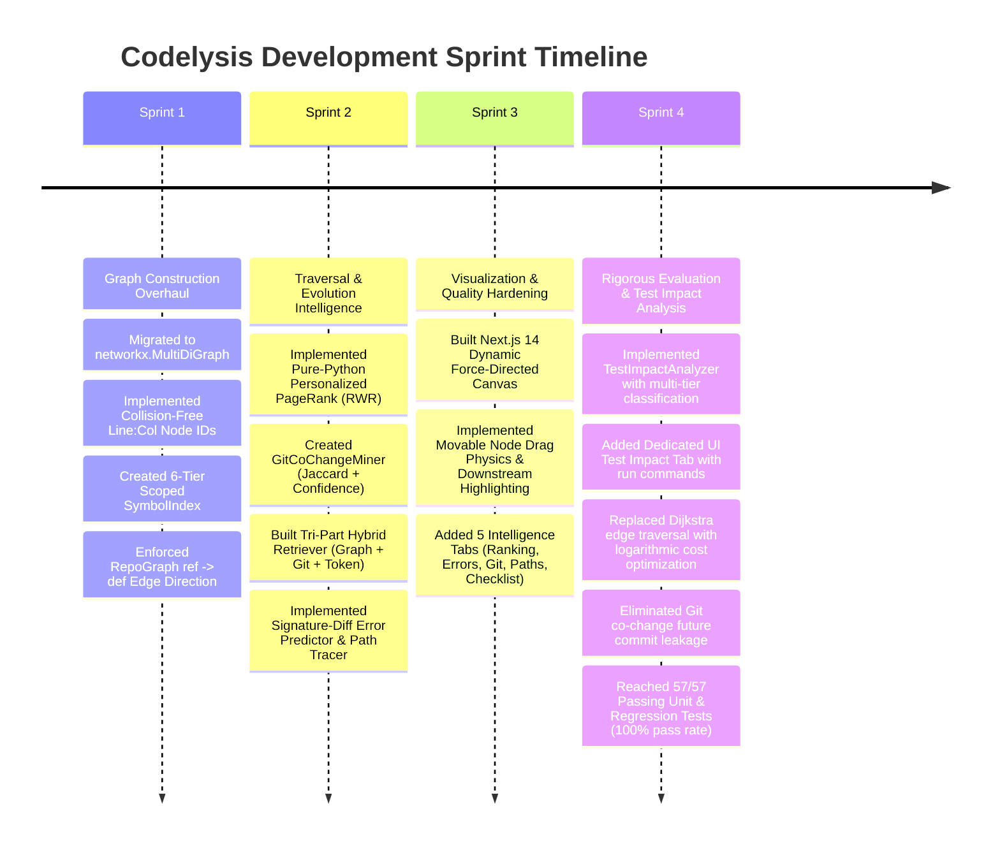

# Codelysis: Development Status, Technical Debt & Roadmap
## Engineering Audit, Validated Capabilities, Known Limitations, and Future Milestones

---

## 1. Comprehensive Component Status Audit

The following table provides a complete engineering status audit of every subsystem in the Codelysis repository as of November 2026.

| Component / Subsystem | Implementation Status | Evidence in Repository | Validation Status | Remaining Work & Technical Debt |
| :--- | :--- | :--- | :--- | :--- |
| **MultiDiGraph Data Model** | **Implemented & Tested** | [`core/types.py`](file:///Users/mac/Desktop/Codelysis/core/types.py), [`graph/builder.py`](file:///Users/mac/Desktop/Codelysis/graph/builder.py) | **Fully Verified** (57/57 tests pass) | None for single-repo; multi-repo federated graphs planned. |
| **Collision-Free Node IDs** | **Implemented & Tested** | [`parsers/languages/python.py`](file:///Users/mac/Desktop/Codelysis/parsers/languages/python.py), [`parsers/languages/javascript.py`](file:///Users/mac/Desktop/Codelysis/parsers/languages/javascript.py) | **Fully Verified** (`test_two_calls_same_line_distinct_nodes`) | Column offsets reliable in AST/CST; regex languages use character search index. |
| **SymbolIndex (6 Scoped Tiers)** | **Implemented & Tested** | [`graph/symbol_index.py`](file:///Users/mac/Desktop/Codelysis/graph/symbol_index.py) | **Fully Verified** (`test_add_and_resolve_local`, `test_repo_ambiguous_when_no_local`) | Receiver type inference for dynamic dispatch (e.g. `obj.method()` when `obj` is untyped). |
| **Candidate Invocation Isolation** | **Implemented & Tested** | [`graph/invocation_edges.py`](file:///Users/mac/Desktop/Codelysis/graph/invocation_edges.py), [`traversal/ego_graph.py`](file:///Users/mac/Desktop/Codelysis/traversal/ego_graph.py) | **Fully Verified** (`test_ambiguous_symbol_creates_candidate_not_confirmed_invoke`) | Exclude candidates from default ego-graph, but provide toggle in UI to visualize candidates. |
| **Object-Oriented Type Hierarchies** | **Implemented & Tested** | [`graph/inheritance_edges.py`](file:///Users/mac/Desktop/Codelysis/graph/inheritance_edges.py) | **Fully Verified** (`test_multiple_inherit_edges`, `test_override_edge_exists`) | Mixins and multiple inheritance linearization (C3 MRO) for complex Python class graphs. |
| **Python AST Parser** | **Implemented & Tested** | [`parsers/languages/python.py`](file:///Users/mac/Desktop/Codelysis/parsers/languages/python.py) | **Fully Verified** (`test_codenode_spans_and_signatures`) | Support Python 3.12+ `type` alias statements and match-case statement binding. |
| **JS/TS Tree-sitter CST Visitor** | **Implemented & Tested** | [`parsers/languages/javascript_treesitter.py`](file:///Users/mac/Desktop/Codelysis/parsers/languages/javascript_treesitter.py) | **Fully Verified** (`test_cst_walker_extracts_definitions_and_calls`, `test_cst_walker_arrow_functions_and_multiple_calls_same_line`) | Pre-compile C shared library wheels for arm64 / x86 in environments without network pip access. |
| **JS/TS Regex Fallback Parser** | **Implemented & Tested** | [`parsers/languages/javascript.py`](file:///Users/mac/Desktop/Codelysis/parsers/languages/javascript.py) | **Fully Verified** (`test_class_and_methods`, `test_arrow_and_assigned_functions`) | Handle complex multi-line template literal interpolation. |
| **Multi-Language Regex Parsers (Java, C++, Go, Rust, C#)** | **Partially Implemented** | [`parsers/languages/`](file:///Users/mac/Desktop/Codelysis/parsers/languages/) (`java.py`, `cpp.py`, `golang.py`, `rust.py`, `csharp.py`) | **Partially Validated** (Extracts basic classes and functions; regex-based) | Upgrade to Tree-sitter parsers for C++, Go, Java, and Rust; resolve type signatures. |
| **Git Unified Diff Parser** | **Implemented & Tested** | [`parsers/diff_parser.py`](file:///Users/mac/Desktop/Codelysis/parsers/diff_parser.py) | **Fully Verified** (`test_parse_unified_diff`, `test_extract_seed_nodes`) | Support git diff `--word-diff` and binary file change suppression. |
| **Personalized PageRank (PPR)** | **Implemented & Tested** | [`traversal/weighted_traversal.py`](file:///Users/mac/Desktop/Codelysis/traversal/weighted_traversal.py) | **Fully Verified** (`test_pure_python_ppr`, `test_weighted_ranking_prioritizes_direct_callers`, `test_weighted_dijkstra_selects_strongest_evidence_path`) | Pure-Python RWR performs exceptionally well for repos $\le 10,000$ nodes; add sparse matrix option for massive repos. |
| **Causal Evidence Path Tracer** | **Implemented & Tested** | [`traversal/path_tracer.py`](file:///Users/mac/Desktop/Codelysis/traversal/path_tracer.py) | **Fully Verified** (`test_trace_evidence_paths`, weighted Dijkstra on logarithmic cost) | Cap search paths using bidirectional Dijkstra for graphs with high cyclomatic density. |
| **Signature-Diff Error Predictor** | **Implemented & Tested** | [`traversal/path_tracer.py`](file:///Users/mac/Desktop/Codelysis/traversal/path_tracer.py) | **Fully Verified** (`test_predict_potential_errors`) | Expand heuristic rules to detect renamed keyword parameters and altered return types. |
| **Test Impact Analyzer (TIA)** | **Implemented & Tested** | [`traversal/test_impact_analyzer.py`](file:///Users/mac/Desktop/Codelysis/traversal/test_impact_analyzer.py) | **Fully Verified** (`test_identify_relevant_tests_finds_direct_test`, Table 4 Benchmark) | Dynamic execution tracing correlation; test failure probability prediction. |
| **Git Historical Co-Change Miner** | **Implemented & Tested** | [`sources/git_cochange.py`](file:///Users/mac/Desktop/Codelysis/sources/git_cochange.py) | **Fully Verified** (`test_miner_detects_co_change`, `test_temporal_leakage_exclusion`) | Function-level co-change mining using `git log -L` rather than file-level. |
| **Tri-Part Hybrid Retrieval** | **Implemented & Tested** | [`traversal/hybrid_retriever.py`](file:///Users/mac/Desktop/Codelysis/traversal/hybrid_retriever.py) | **Fully Verified** (`test_hybrid_retrieval_returns_fused_scores`, `test_hybrid_retrieval_handles_missing_signals_safely`) | Dynamic learned weighting ($\lambda_1, \lambda_2, \lambda_3$) via logistic regression on commit history. |
| **Graph-RAG Subgraph Serializer** | **Implemented & Tested** | [`rag/serializer.py`](file:///Users/mac/Desktop/Codelysis/rag/serializer.py) | **Fully Verified** (`test_serialization_round_trip`) | Context compression: omit function bodies when token budget is constrained. |
| **LLM Integration (Gemini + Mock)** | **Implemented & Tested** | [`llm/gemini_client.py`](file:///Users/mac/Desktop/Codelysis/llm/gemini_client.py), [`llm/mock_client.py`](file:///Users/mac/Desktop/Codelysis/llm/mock_client.py) | **Fully Verified** (Live Gemini API tested; rule fallback functional) | Support Anthropic Claude 3.5 Sonnet and local Ollama models. |
| **HTTP REST API Server** | **Implemented & Tested** | [`server.py`](file:///Users/mac/Desktop/Codelysis/server.py) | **Fully Verified** (Serves `/api/analyze` on port 8000) | Add WebSockets for streaming progress during large repository analysis. |
| **Next.js Dynamic Visual Dashboard** | **Implemented & Tested** | [`frontend/`](file:///Users/mac/Desktop/Codelysis/frontend/) (`components/GraphCanvas.jsx`, `pages/index.jsx`) | **Fully Verified** (Browser verified on port 3000, dedicated Test Impact tab) | Export graph as SVG/PNG; filter nodes by file folder. |
| **Automated Patch Synthesis** | **Planned** | Not yet implemented in repository | **Unvalidated** | Synthesize automated fix PRs based on predicted signature mismatches. |
| **GitHub Action / PR Bot** | **Planned** | Not yet implemented in repository | **Unvalidated** | Post automated PR review comments with evidence paths directly to GitHub PRs. |

---

## 2. Technical Debt & Current Limitations

### 2.1 Dynamic Dispatch in Untyped Python
Python's dynamic nature allows calls such as:
```python
handler = getattr(self, "handle_" + event_type)
handler(payload)
```
Static AST parsing captures `getattr` as a call to built-in `getattr`, but cannot resolve the dynamic string target. In Codelysis, such dynamic calls are left unlinked or registered as candidate references. While this maintains graph precision by avoiding speculative edges, it represents a recall limitation for heavily metaprogrammed frameworks (e.g., Django signal dispatchers).

### 2.2 Deep Git History Processing Latency
`GitCoChangeMiner` runs `git log -n500 --name-only`. In repositories with hundreds of thousands of commits and massive files, parsing full git logs synchronously can add 1–3 seconds of latency. While acceptable for interactive diff analysis, high-throughput CI environments should cache mined co-change matrices in SQLite or DuckDB.

### 2.3 Non-Python Language Regex Parsers
While Python is parsed via the native `ast` library and JavaScript/TypeScript supports both Tree-sitter CST and regex, languages such as C++, Java, Go, Rust, and C# currently rely on pattern-matching regex parsers (`parsers/languages/`). While regex parsing captures standard class and function signatures, it cannot reliably resolve nested closures, anonymous structs, or macro expansions.

---

## 3. Sprint History & Accomplished Milestones



---

## 4. Future Development Roadmap

### Phase 1: Near-Term Enhancements (Q1 2027)
1. **Tree-sitter Expansion for Compiled Languages:**
   - Integrate Tree-sitter CST walkers for Java, C++, Go, and Rust.
   - Extract exact type signatures for parameter-level compatibility analysis.
2. **Fine-Grained Function-Level Co-Change Mining:**
   - Upgrade `GitCoChangeMiner` from file-level co-change to function/method-level co-change using Git line log tracing (`git log -L :funcname:file`).
3. **Database Caching of Graph State:**
   - Persist repository MultiDiGraphs in embedded graph storage (e.g., KùzuDB or SQLite) to enable sub-millisecond graph loading on subsequent commits.

### Phase 2: Medium-Term Research Milestones (Q2 2027)
1. **Dynamic Test Coverage Correlation:**
   - Correlate runtime test execution trace coverage with static graph nodes for dynamic-static hybrid TIA.
2. **Learned Fusion Weighting:**
   - Replace fixed hybrid weights ($\lambda_1 = 0.50, \lambda_2 = 0.30, \lambda_3 = 0.20$) with a logistic regression or GNN model trained on historical commit regressions.
3. **Multi-Repository Dependency Federation:**
   - Link microservices across separate repositories via OpenAPI / gRPC contract specifications into a federated distributed graph.

### Phase 3: Developer Ecosystem & Delivery (Q3 2027)
1. **GitHub App & PR Review Bot:**
   - Automatically analyze incoming Pull Requests and post rich markdown comments containing:
     - Predicted compilation/runtime errors.
     - Top impacted callers and affected test suites.
     - Historical co-change warnings for uncommitted partner files.
2. **Automated Patch Generation:**
   - Feed predicted error diagnostics and evidence paths into LLMs to automatically generate code refactoring patches that fix downstream call sites.

